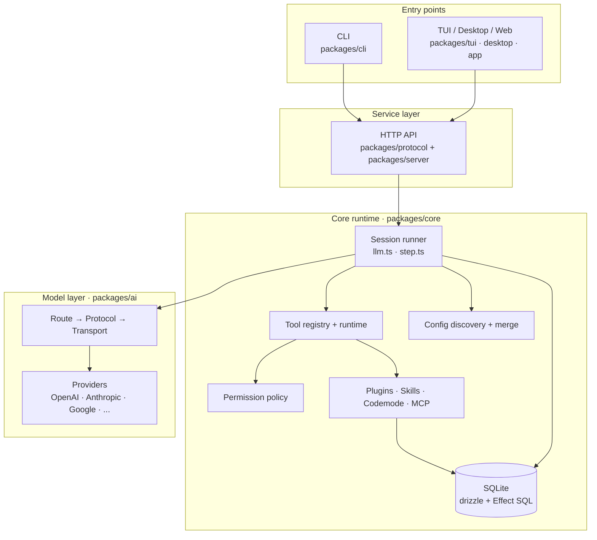

<p align="center">
  <a href="https://opencode.ai">
    <picture>
      <source srcset=".github/assets/logo-ornate-dark.svg" media="(prefers-color-scheme: dark)">
      <source srcset=".github/assets/logo-ornate-light.svg" media="(prefers-color-scheme: light)">
      
    </picture>
  </a>
</p>
<p align="center">The open source AI coding agent.</p>
<p align="center">
  <a href="https://opencode.ai/discord"></a>
  <a href="https://www.npmjs.com/package/@opencode/cli"></a>
  <a href="https://github.com/anomalyco/opencode/actions/workflows/release.yml"></a>
</p>

<p align="center">
  <a href="README.md">English</a> |
  <a href="README.zh.md">简体中文</a> |
  <a href="README.zht.md">繁體中文</a> |
  <a href="README.ko.md">한국어</a> |
  <a href="README.de.md">Deutsch</a> |
  <a href="README.es.md">Español</a> |
  <a href="README.fr.md">Français</a> |
  <a href="README.it.md">Italiano</a> |
  <a href="README.da.md">Dansk</a> |
  <a href="README.ja.md">日本語</a> |
  <a href="README.pl.md">Polski</a> |
  <a href="README.ru.md">Русский</a> |
  <a href="README.bs.md">Bosanski</a> |
  <a href="README.ar.md">العربية</a> |
  <a href="README.no.md">Norsk</a> |
  <a href="README.br.md">Português (Brasil)</a> |
  <a href="README.th.md">ไทย</a> |
  <a href="README.tr.md">Türkçe</a> |
  <a href="README.uk.md">Українська</a> |
  <a href="README.bn.md">বাংলা</a> |
  <a href="README.gr.md">Ελληνικά</a> |
  <a href="README.vi.md">Tiếng Việt</a>
</p>

[](https://opencode.ai)

---

### Installation

```bash
# YOLO
curl -fsSL https://opencode.ai/v2/install | bash

# Package managers
npm i -g @opencode/cli@latest      # or bun/pnpm/yarn
brew install anomalyco/tap/opencode-v2 # macOS and Linux (recommended, always up to date)
brew install opencode              # macOS and Linux (official brew formula, updated less)
sudo pacman -S opencode            # Arch Linux (Stable)
paru -S opencode-beta              # Arch Linux (Latest from AUR)
mise use -g opencode               # Any OS
nix run github:anomalyco/opencode  # Nix
```

> [!TIP]
> Remove versions older than 0.1.x before installing.

### Desktop App (BETA)

OpenCode is also available as a desktop application. Download it from [opencode.ai/download](https://opencode.ai/download).

| Platform              | Download                           |
| --------------------- | ---------------------------------- |
| macOS (Apple Silicon) | `opencode-desktop-mac-arm64.dmg`   |
| macOS (Intel)         | `opencode-desktop-mac-x64.dmg`     |
| Windows               | `opencode-desktop-win-x64.exe`     |
| Linux                 | `.deb`, `.rpm`, or `.AppImage`     |

```bash
# macOS (Homebrew)
brew install --cask opencode-desktop
```

#### Installation Directory

The install script installs OpenCode to `$HOME/.opencode/bin`.

### Agents

OpenCode includes two built-in agents you can switch between with the `Tab` key.

- **build** - Default, full-access agent for development work
- **plan** - Read-only agent for analysis and code exploration
  - Denies file edits by default
  - Asks permission before running bash commands
  - Ideal for exploring unfamiliar codebases or planning changes

Also included is a **general** subagent for complex searches and multistep tasks.
This is used internally and can be invoked using `@general` in messages.

Learn more about [agents](https://opencode.ai/docs/agents).

### Architecture

OpenCode is a Bun + TypeScript monorepo that uses [Effect](https://effect.website/) for typed, composable concurrency and error handling. The system is layered: front ends talk to an HTTP server, the server hands work to a **session runner** that drives the agent loop, and that loop goes through a provider-agnostic model layer, a permission-checked tool layer and a pluggable extension layer. State lives in a local SQLite database.



#### Repository layout

| Path | Responsibility |
| --- | --- |
| `packages/schema` | Shared types (agent, permission, messages, provider, config). The bottom of the dependency graph. |
| `packages/core` | Agent definitions, session runner, tools, permissions, config discovery, skills, database migrations. |
| `packages/ai` | Provider-agnostic LLM layer: routes, wire protocols, transports, auth, media generation. |
| `packages/protocol` | Typed `HttpApi` contract shared by server and clients. |
| `packages/server` | HTTP server that implements the protocol and assembles ~40 API groups. |
| `packages/client` | Generated HTTP client — never edited by hand. |
| `packages/sdk` | Public SDK composing client, core and server. |
| `packages/plugin` | Plugin authoring API in two styles: native Effect and Promise (adapted into Effect). |
| `packages/cli` | Executable, command tree, and the managed background server process. |
| `packages/tui`, `ui`, `session-ui`, `app`, `desktop` | Terminal, web and desktop user interfaces. |
| `packages/codemode` | Sandboxed code execution against schema-described tools. |
| `packages/cli-rs` | Rust native CLI (17 crates), kept in behavioral parity with the TypeScript TUI. |
| `services/*` | Website, docs, and the data, files, update and legacy services. |

Dependency direction is deliberate and enforced: `schema → core/protocol → server`. Runtime code in `client` may depend on `schema` and `protocol` but **never** on `core` or `server`; `sdk` is the only package that composes all three.

#### Entry points and request lifecycle

The installed launcher (`packages/cli/bin/opencode.cjs`) spawns a platform-native binary; the source entry is `packages/cli/src/index.ts`, which runs the effect/cli command tree in `packages/cli/src/commands/commands.ts`. The default handler resolves or starts a background server (`ServerConnection.resolve`), then launches the TUI (`packages/tui/src/index.tsx`). The TUI and desktop app are thin clients: they call the server over the typed protocol rather than running agent logic locally. A one-shot prompt takes the shorter path `packages/cli/src/run/run.ts → client.session.prompt`.

Every user message enters a session and is processed by `drain` in `packages/core/src/session/runner/llm.ts`. Before each turn, `drain` checks the session inbox for promotable work (compaction, move, steer), settles expired compactions and outstanding tool calls, then loops step by step: prepare context → auto-compact if needed → resolve the primary model → `steps.attempt` → branch on the returned `Outcome`.

| Outcome | Meaning |
| --- | --- |
| `Completed` | Step finished; `needsContinuation` decides whether another turn is required. |
| `Retry` | Recoverable model failure; carries the error, retry decision and optionally a fresh assistant message. |
| `RecoverFull` | Transport requires full-context recovery and a replay. |
| `Compacted` | Context overflow triggered compaction; continue with the compacted context. |
| `OutputLimit` | Model hit its output token limit; two consecutive occurrences are treated as a failure. |

`packages/ai/src/loop.ts` is a stateless toolbox of pure helpers for this loop (for example, deciding which tool calls are still pending). The actual AI SDK stream loop lives in `packages/ai/src/llm.ts` as `driveLoop`. The boundary matters when debugging: orchestration state is in `core`, streaming mechanics are in `ai`.

#### Model layer

A provider is a factory in `packages/ai/src/providers/` (for example `openai.ts`). `configure()` binds authentication (`AuthOptions.bearer`) and a base URL, then exposes model constructors for chat/responses, image, speech, transcription, decision and embedding. Each provider declares an ordered `routes` list — OpenAI prefers the Responses route and falls back to Chat Completions. A request flows `session runner → model-request.ts → ai.request → Route → Protocol → Transport → provider endpoint`. Moving a provider between vendors therefore means adding a protocol or route, not changing the session runner.

#### Tools and permissions

Tools are registered through `Tool.Service` in `packages/core/src/tool.ts`; `packages/core/src/tool/runtime.ts` handles definition decoding, execution and output encoding, collapsing every failure into a `Tool.Error` result so the model can see it and correct itself. Built-in tools live in `packages/core/src/tool/plugin/`: `read`, `write`, `edit`, `patch`, `glob`, `grep`, `shell`, `webfetch`, `websearch`, `todo`, `skill`, `subagent`, `question`, `image-generate`, `video-generate` and others. Execution is wrapped in `execute.before` / `execute.after` hooks, and each tool checks permission internally. External tools arrive over MCP (`packages/core/src/mcp/`) and are namespaced as `server__tool` by `packages/core/src/tool/mcp.ts`.

Permission rules are `{action, resource, effect}` triples with `effect` of `allow`, `ask` or `deny` (`packages/schema/src/permission.ts`). Matching uses `findLast`, so **the last matching rule wins** — a broad allow can be narrowed by a later, more specific deny, but not the reverse. The policy engine (`packages/core/src/permission/policy.ts`) supports four shapes: `rules`, `override` (layered last-match-wins), `restrict` (a deny that cannot be undone by lower layers) and `fallback` (only settles `ask`). With no match, the default is `ask`, never allow-all.

#### Extension mechanisms

Plugins can be authored either as native Effect modules (`packages/plugin/src/effect/`, `define({ id, effect(ctx) })`) or as ordinary Promise modules adapted into the Effect host (`packages/plugin/src/promise/`). Hooks in `packages/core/src/plugin/hooks.ts` cover the `session` lifecycle (fork, prompt, context, compaction, generate, title, `model.request`, retry, idle), `permission.evaluate`, `shell.create.before`, `tool.execute.before/after` and the AI SDK layer. Only `execute.before` may fail and abort the operation.

Skills are `SKILL.md` files discovered by `packages/core/src/skill/` and exposed through a `skill://` URI. Codemode (`packages/codemode`) runs code in a sandbox against tools described by schemas, with its own permission isolation and an `opencode://` API.

#### Storage and configuration

The database layer uses drizzle-orm with Effect SQL over SQLite (`packages/core/src/database/`), with WAL pragmas and generated migrations. Core tables cover sessions, messages and parts, the inbox, projects, permissions, credentials, jobs, key-value data, workspaces, worktrees, machines, automations and blobs. The HTTP surface is assembled in `packages/server/src/api.ts` from the ~40 API groups in `packages/protocol/src/groups/`.

Configuration is discovered from many sources — system, MDM preferences, global, integration, remote well-known, explicit `--config`, project, `.claude`/`.agents` and content overlays (`packages/core/src/config/`). Entries are ordered from lowest to highest priority, and `latest(entries, key)` uses `findLast` so the highest-priority document that defines a key wins. Managed policies are loaded first for exactly this reason.

#### Native client and parity

`packages/cli-rs` is a Rust workspace of 17 crates (`acp`, `api`, `cli`, `plugin`, `store`, `tui`, `ui`, `local`, `service`, `mini`, `mermaid`, `latex`, and others). It is an HTTP client of the same OpenCode server and shares sessions, the background service and `cli.json` with the TypeScript client. The `parity/` directory holds fixtures and recorded scenarios that replay the same interactions against both implementations; `parity/deviations/` documents known differences and `bun run check:drift` guards against them.

### Documentation

For more info on how to configure OpenCode, [**head over to our docs**](https://opencode.ai/docs).

### Contributing

If you're interested in contributing to OpenCode, please read our [contributing docs](./CONTRIBUTING.md) before submitting a pull request.

### Building on OpenCode

If you are working on a project that's related to OpenCode and is using "opencode" as part of its name, for example "opencode-dashboard" or "opencode-mobile", please add a note to your README to clarify that it is not built by the OpenCode team and is not affiliated with us in any way.

---

**Join our community** [Discord](https://discord.gg/opencode) | [X.com](https://x.com/opencode)
