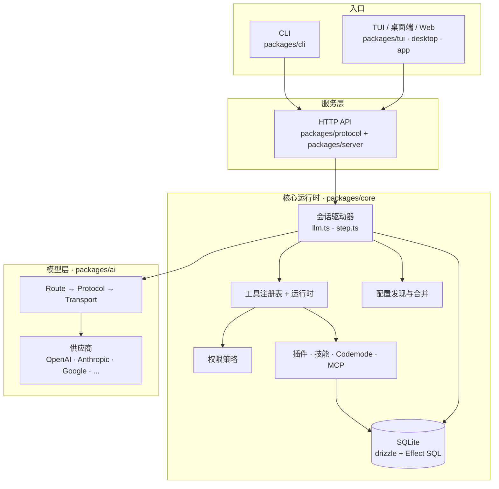

<p align="center">
  <a href="https://opencode.ai">
    <picture>
      <source srcset=".github/assets/logo-ornate-dark.svg" media="(prefers-color-scheme: dark)">
      <source srcset=".github/assets/logo-ornate-light.svg" media="(prefers-color-scheme: light)">
      
    </picture>
  </a>
</p>
<p align="center">开源的 AI Coding Agent。</p>
<p align="center">
  <a href="https://opencode.ai/discord"></a>
  <a href="https://www.npmjs.com/package/@opencode/cli"></a>
  <a href="https://github.com/anomalyco/opencode/actions/workflows/release.yml"></a>
</p>

<p align="center">
  <a href="README.md">English</a> |
  <a href="README.zh.md">简体中文</a> |
  <a href="README.zht.md">繁體中文</a> |
  <a href="README.ko.md">한국어</a> |
  <a href="README.de.md">Deutsch</a> |
  <a href="README.es.md">Español</a> |
  <a href="README.fr.md">Français</a> |
  <a href="README.it.md">Italiano</a> |
  <a href="README.da.md">Dansk</a> |
  <a href="README.ja.md">日本語</a> |
  <a href="README.pl.md">Polski</a> |
  <a href="README.ru.md">Русский</a> |
  <a href="README.bs.md">Bosanski</a> |
  <a href="README.ar.md">العربية</a> |
  <a href="README.no.md">Norsk</a> |
  <a href="README.br.md">Português (Brasil)</a> |
  <a href="README.th.md">ไทย</a> |
  <a href="README.tr.md">Türkçe</a> |
  <a href="README.uk.md">Українська</a> |
  <a href="README.bn.md">বাংলা</a> |
  <a href="README.gr.md">Ελληνικά</a> |
  <a href="README.vi.md">Tiếng Việt</a>
</p>

[](https://opencode.ai)

---

### 安装

```bash
# 直接安装 (YOLO)
curl -fsSL https://opencode.ai/v2/install | bash

# 软件包管理器
npm i -g @opencode/cli@latest      # 也可使用 bun/pnpm/yarn
brew install anomalyco/tap/opencode-v2 # macOS 和 Linux（推荐，始终保持最新）
brew install opencode              # macOS 和 Linux（官方 brew formula，更新频率较低）
sudo pacman -S opencode            # Arch Linux (Stable)
paru -S opencode-beta              # Arch Linux (Latest from AUR)
mise use -g opencode               # 任意系统
nix run github:anomalyco/opencode  # Nix
```

> [!TIP]
> 安装前请先移除 0.1.x 之前的旧版本。

### 桌面应用程序 (BETA)

OpenCode 也提供桌面版应用。可从 [opencode.ai/download](https://opencode.ai/download) 下载。

| 平台                  | 下载文件                           |
| --------------------- | ---------------------------------- |
| macOS (Apple Silicon) | `opencode-desktop-mac-arm64.dmg`   |
| macOS (Intel)         | `opencode-desktop-mac-x64.dmg`     |
| Windows               | `opencode-desktop-win-x64.exe`     |
| Linux                 | `.deb`、`.rpm` 或 AppImage         |

```bash
# macOS (Homebrew Cask)
brew install --cask opencode-desktop
```

#### 安装目录

安装脚本将 OpenCode 安装到 `$HOME/.opencode/bin`。

### Agents

OpenCode 内置两种 Agent，可用 `Tab` 键快速切换：

- **build** - 默认模式，具备完整权限，适合开发工作
- **plan** - 只读模式，适合代码分析与探索
  - 默认拒绝修改文件
  - 运行 bash 命令前会询问
  - 便于探索未知代码库或规划改动

另外还包含一个 **general** 子 Agent，用于复杂搜索和多步任务，内部使用，也可在消息中输入 `@general` 调用。

了解更多 [Agents](https://opencode.ai/docs/agents) 相关信息。

### 架构

OpenCode 是一个基于 Bun + TypeScript 的 monorepo，使用 [Effect](https://effect.website/) 处理类型安全、可组合的并发与错误。系统按层组织：各类前端通过 HTTP 与服务层通信，服务层把工作交给**会话驱动器（session runner）**，由它驱动 Agent 循环，依次经过与供应商无关的模型层、带权限校验的工具层，以及可插拔的扩展层。状态存放在本地 SQLite 数据库中。



#### 仓库结构

| 路径 | 职责 |
| --- | --- |
| `packages/schema` | 共享类型（Agent、权限、消息、供应商、配置），位于依赖图最底层。 |
| `packages/core` | Agent 定义、会话驱动器、工具、权限、配置发现、技能、数据库迁移。 |
| `packages/ai` | 与供应商无关的大模型层：路由、线协议、传输、认证、多模态生成。 |
| `packages/protocol` | 服务端与客户端共享的类型化 `HttpApi` 契约。 |
| `packages/server` | 实现协议并装配约 40 个 API 分组的 HTTP 服务。 |
| `packages/client` | 由契约生成的 HTTP 客户端，不应手工修改。 |
| `packages/sdk` | 组合 client、core、server 的公共 SDK。 |
| `packages/plugin` | 插件编写 API，提供原生 Effect 与 Promise（适配进 Effect）两种风格。 |
| `packages/cli` | 可执行入口、命令树，以及托管的后台服务进程。 |
| `packages/tui`、`ui`、`session-ui`、`app`、`desktop` | 终端、Web 与桌面端界面。 |
| `packages/codemode` | 在沙箱中按 schema 描述执行工具代码。 |
| `packages/cli-rs` | Rust 原生 CLI（17 个 crate），与 TypeScript TUI 保持行为对等。 |
| `services/*` | 官网、文档，以及 data / files / update / legacy 服务。 |

依赖方向是刻意约束的：`schema → core/protocol → server`。`client` 的运行时代码可以依赖 `schema` 和 `protocol`，但**绝不能**依赖 `core` 或 `server`；只有 `sdk` 会同时组合这三者。

#### 入口与请求生命周期

安装后的启动器（`packages/cli/bin/opencode.cjs`）会拉起平台原生二进制；源码入口是 `packages/cli/src/index.ts`，它运行 `packages/cli/src/commands/commands.ts` 中的 effect/cli 命令树。默认处理器会解析或启动后台服务（`ServerConnection.resolve`），再拉起 TUI（`packages/tui/src/index.tsx`）。TUI 和桌面端是轻量客户端：它们通过类型化协议调用服务，而不是在本地运行 Agent 逻辑。一次性提示走更短的路径：`packages/cli/src/run/run.ts → client.session.prompt`。

每条用户消息都会进入会话，由 `packages/core/src/session/runner/llm.ts` 中的 `drain` 处理。每一轮开始时，`drain` 先检查会话收件箱中可提升的工作（压缩、移动、转向），结算已过期的压缩与未完成的工具调用，然后逐步循环：准备上下文 → 必要时自动压缩 → 解析主模型 → `steps.attempt` → 根据返回的 `Outcome` 分支。

| Outcome | 含义 |
| --- | --- |
| `Completed` | 本步完成；`needsContinuation` 决定是否需要继续下一轮。 |
| `Retry` | 可恢复的模型调用失败；携带错误、重试决策，以及可选的新助手消息。 |
| `RecoverFull` | 传输层要求全量恢复并重放。 |
| `Compacted` | 上下文溢出触发了压缩，用压缩后的上下文继续。 |
| `OutputLimit` | 模型触顶输出词元数；连续两次会被判为失败。 |

`packages/ai/src/loop.ts` 是这个循环的纯函数工具箱（例如判断哪些工具调用仍待执行）。真正的 AI SDK 流式循环在 `packages/ai/src/llm.ts` 的 `driveLoop`。这个边界在排查问题时很关键：编排状态在 `core`，流式机制在 `ai`。

#### 模型层

一个供应商就是 `packages/ai/src/providers/` 下的一个工厂（例如 `openai.ts`）。`configure()` 绑定认证（`AuthOptions.bearer`）与 base URL，然后暴露 chat/responses、图片、语音、转写、决策和向量嵌入的模型构造器。每个供应商声明有序的 `routes` 列表——OpenAI 优先 Responses 路由，回退到 Chat Completions。请求链路是 `会话驱动器 → model-request.ts → ai.request → Route → Protocol → Transport → 供应商端点`。因此更换底层供应商只需新增协议或路由，不必修改会话驱动器。

#### 工具与权限

工具通过 `packages/core/src/tool.ts` 的 `Tool.Service` 注册；`packages/core/src/tool/runtime.ts` 负责定义解码、执行与输出编码，并把所有失败收敛成 `Tool.Error` 结果，让模型能看到并自行纠正。内置工具位于 `packages/core/src/tool/plugin/`：`read`、`write`、`edit`、`patch`、`glob`、`grep`、`shell`、`webfetch`、`websearch`、`todo`、`skill`、`subagent`、`question`、`image-generate`、`video-generate` 等。执行过程包裹在 `execute.before` / `execute.after` 钩子中，每个工具内部都会校验权限。外部工具通过 MCP（`packages/core/src/mcp/`）接入，并由 `packages/core/src/tool/mcp.ts` 命名空间化为 `server__tool`。

权限规则是 `{action, resource, effect}` 三元组，`effect` 取 `allow`、`ask` 或 `deny`（`packages/schema/src/permission.ts`）。匹配使用 `findLast`，也就是**最后匹配的规则生效**——宽泛的 allow 可以被后面更具体的 deny 收窄，反过来则不行。策略引擎（`packages/core/src/permission/policy.ts`）支持四种形式：`rules`、`override`（层层叠加、后匹配优先）、`restrict`（下层无法撤销的 deny）和 `fallback`（只结算 `ask`）。没有命中时默认是 `ask`，而绝非全部放行。

#### 扩展机制

插件既可以用原生 Effect 模块编写（`packages/plugin/src/effect/`，`define({ id, effect(ctx) })`），也可以用普通 Promise 模块编写，再由 `packages/plugin/src/promise/` 适配进 Effect 宿主。`packages/core/src/plugin/hooks.ts` 中的钩子覆盖 `session` 生命周期（fork、prompt、context、compaction、generate、title、`model.request`、retry、idle）、`permission.evaluate`、`shell.create.before`、`tool.execute.before/after` 以及 AI SDK 层。只有 `execute.before` 可以失败并中止操作。

技能是由 `packages/core/src/skill/` 发现的 `SKILL.md` 文件，通过 `skill://` URI 暴露。Codemode（`packages/codemode`）在沙箱中按 schema 描述的工具执行代码，具备独立的权限隔离和 `opencode://` API。

#### 存储与配置

数据库层使用 drizzle-orm 加 Effect SQL 操作 SQLite（`packages/core/src/database/`），启用 WAL 参数并带自动生成的迁移。核心表覆盖会话、消息与片段、收件箱、项目、权限、凭据、作业、键值数据、工作区、工作树、机器、自动化和 blob。HTTP 接口由 `packages/server/src/api.ts` 从 `packages/protocol/src/groups/` 的约 40 个 API 分组装配而成。

配置来源很多——系统级、MDM 首选项、全局、集成、远程 well-known、显式 `--config`、项目、`.claude`/`.agents` 以及内容覆盖层（`packages/core/src/config/`）。条目按优先级从低到高排列，`latest(entries, key)` 用 `findLast` 取定义了该键的最高优先级文档。托管策略最先加载，正是为了获得最高优先级。

#### 原生客户端与对等性

`packages/cli-rs` 是由 17 个 crate 组成的 Rust workspace（`acp`、`api`、`cli`、`plugin`、`store`、`tui`、`ui`、`local`、`service`、`mini`、`mermaid`、`latex` 等）。它同样是 OpenCode 服务的 HTTP 客户端，与 TypeScript 客户端共享会话、后台服务和 `cli.json`。`parity/` 目录保存夹具和录制好的场景，对两套实现回放相同的交互；`parity/deviations/` 记录已知差异，`bun run check:drift` 用于防止漂移。

### 文档

更多配置说明请查看我们的 [**官方文档**](https://opencode.ai/docs)。

### 参与贡献

如有兴趣贡献代码，请在提交 PR 前阅读 [贡献指南 (Contributing Docs)](./CONTRIBUTING.md)。

### 基于 OpenCode 进行开发

如果你在项目名中使用了 “opencode”（如 “opencode-dashboard” 或 “opencode-mobile”），请在 README 里注明该项目不是 OpenCode 团队官方开发，且不存在隶属关系。

---

**加入我们的社区** [飞书](https://applink.feishu.cn/client/chat/chatter/add_by_link?link_token=a53kb082-3aff-41fb-b412-b3e669334f16&qr_code=true) | [X.com](https://x.com/opencode)
